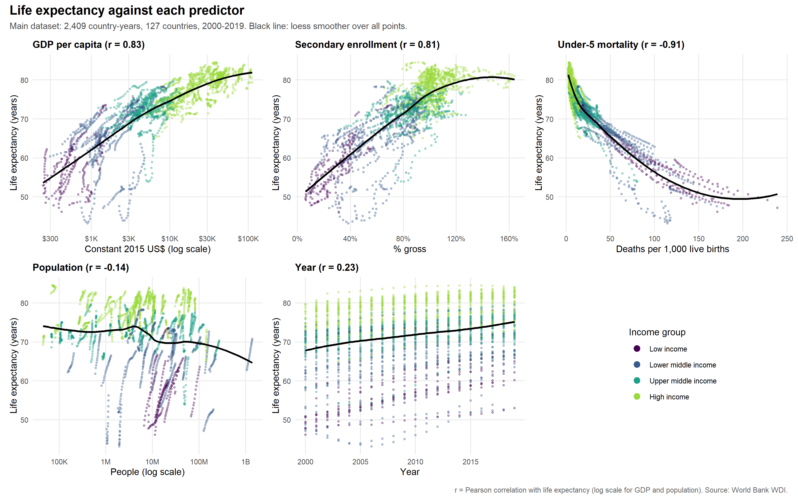
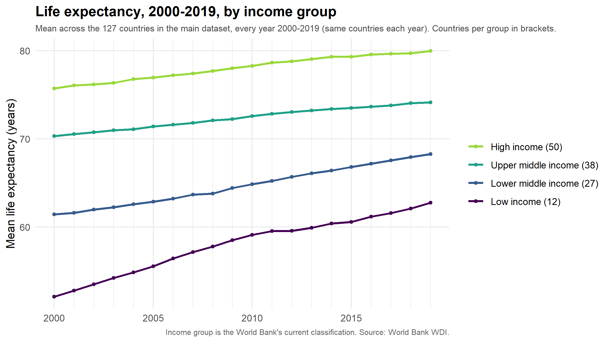
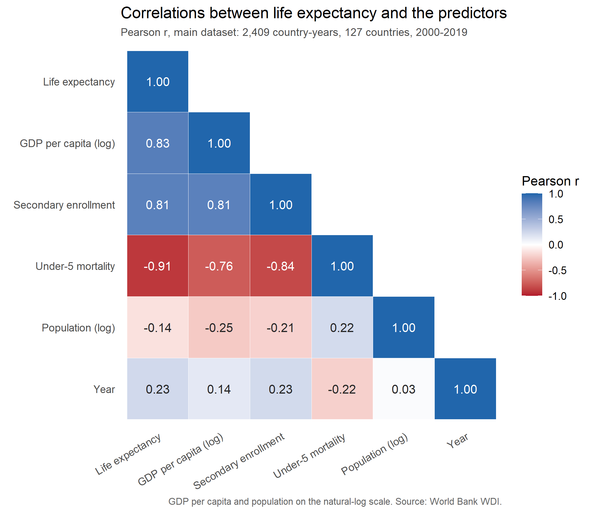

# EDA Findings

What the exploratory figures show, written for the midpoint check-in summary and slides (issue [#7](https://github.com/yohannsharma/long-live/issues/7)). All the figures use the main dataset, `wdi_clean.rds`: 127 countries, 2,409 country-years, 2000–2019. The trends figure is the exception: it uses those same 127 countries but takes life expectancy for all 20 years from the raw download (see Figure 2).

Regenerate the figures from the project root:

```r
source("R/03_eda_histograms.R")   # issue #3
source("R/03_eda_correlation.R")  # issue #4
source("R/03_eda_scatter.R")      # issue #5
source("R/03_eda_trends.R")       # issue #6
```

The three figures below are the polished ones for the check-in. Each has a title, axis labels with units, a source caption, and a 300 dpi PNG in `output/figures/`.

---

## Figure 1. Life expectancy against each predictor



`output/figures/scatter_predictors.png` (single panels: `scatter_<predictor>.png`)

**Interpretation.** Under-5 mortality, GDP per capita and secondary enrollment are all strongly related to life expectancy, but **none of the relationships is a straight line**. GDP per capita rises steadily on a log scale: each doubling of income goes with about 3.4 more years of life expectancy. The curve still flattens at the top: mean life expectancy is 79.1 years for countries at $20–40K and only 80.7 above $40K. Under-5 mortality is the tightest relationship (r = −0.91), but it is clearly curved on its raw scale. Life expectancy falls 3.3 years between the 0–5 and 5–10 deaths-per-1,000 bands, but only 3.1 years between the 100–150 and 150+ bands, which are far wider. Secondary enrollment rises steadily up to about 100% and then levels off (75.9 years at 90–100%, 77.2 at 100–110%). Population and year show only weak patterns. The income-group colours line up along each curve, so the predictors largely track one another. The points that sit well below the curve are mainly in southern and eastern Africa (South Africa, Eswatini, Namibia, Burundi), where life expectancy is lower than child mortality alone would suggest (HIV/AIDS). These are the countries most likely to have large model errors.

**What this means for modeling.** A linear model on raw `u5_mort` will misfit the curve. A log or polynomial term (issue [#15](https://github.com/yohannsharma/long-live/issues/15)) should help, and the tree models can capture the bend on their own.

## Figure 2. Life expectancy trends by income group



`output/figures/life_exp_trend_income.png` (by region: `life_exp_trend_region.png`; both: `life_exp_trends.png`)

**Interpretation.** Life expectancy rose in every income group between 2000 and 2019, and the poorest countries gained the most. Low-income countries went from 52.1 to 62.8 years (+10.6), lower-middle-income countries from 61.4 to 68.3 (+6.9), upper-middle-income countries from 70.3 to 74.1 (+3.8), and high-income countries from 75.7 to 80.0 (+4.2). The gap between high- and low-income countries narrowed from 23.6 to 17.2 years, but it is still large. The three lower groups rose every single year. The high-income mean levelled off in 2015 (a dip of under 0.01 years). By region, Sub-Saharan Africa (+9.2) and South Asia (+8.8) gained the most, while Latin America & Caribbean and Canada (+3.0 each) gained the least. Canada is the only North American country in the data, and it fell slightly in 2017 and 2018.

**Why the raw file.** In the cleaned dataset the set of countries changes from year to year: 83 in 2000, around 125 in 2003–2015 and 106 in 2019, because every predictor has to be present. In 2000, 33 high-income countries are missing. Averaging those rows would make life expectancy appear to jump 2 years between 2000 and 2001 just because of which countries are included. Life expectancy itself is reported for all 127 countries in every year, so the figure uses the same countries every year.

**What this means for modeling.** The test years (2015–2019) average 74.1 years, against 70.9 in the training years (2000–2014), so the test period sits higher than anything the models learn from. Linear models can follow the `year` trend forward. Tree models can't predict beyond the range they were trained on, so they may underpredict the test years. That is worth checking in the model comparison (issue [#25](https://github.com/yohannsharma/long-live/issues/25)).

## Figure 3. Correlation matrix



`output/figures/correlation_matrix.png` (values: `output/tables/correlation_matrix.csv`, Spearman: `correlation_matrix_spearman.csv`)

**Interpretation.** The figure confirms the README's figure of 0.81 for secondary enrollment, and puts the three main predictors in order of how strongly they relate to life expectancy: under-5 mortality (r = −0.91), log GDP per capita (0.83) and secondary enrollment (0.81). Log population (−0.14) and year (0.23) are weak. The bigger finding is that **the three strong predictors are strongly correlated with each other** (0.76–0.84 in absolute value): richer countries have both higher enrollment and lower child mortality. So in a linear model, the coefficient on any one of them depends heavily on which others are included. Ridge regression and elastic net (issue [#16](https://github.com/yohannsharma/long-live/issues/16)) handle this better than plain least squares. Feature-importance results (issue [#26](https://github.com/yohannsharma/long-live/issues/26)) will need care too, because correlated features can share or swap importance. The rank-based (Spearman) correlation for log GDP is higher than the Pearson one (0.88 vs 0.83). Higher income almost always goes with higher life expectancy, but not along a straight line, which matches the flattening in Figure 1.

---

## Supporting figure: distributions

`output/figures/hist_all.png` (single histograms: `hist_*.png`)

Raw GDP per capita (skewness 2.15) and population (9.19) are heavily right-skewed. On the log scale both are roughly symmetric (−0.16 and −0.34), which supports using `log_gdp_pc` and `log_pop`. Under-5 mortality is also right-skewed (2.05; 80% of rows are below 50 per 1,000). Life expectancy is left-skewed (−1.05), with a tail of low values in Sub-Saharan Africa. Secondary enrollment exceeds 100% in 663 rows. That is expected for a *gross* enrollment rate, which counts over-age students, so it isn't an error.

## Caveats for the write-up

- The results describe the 127 countries with enough data. Several large countries, including the US, China, Japan and Brazil, are not included (see `Project-Progress.md`).
- Income group is each country's *current* classification, applied to all years.
- These are correlations, not causal effects.
